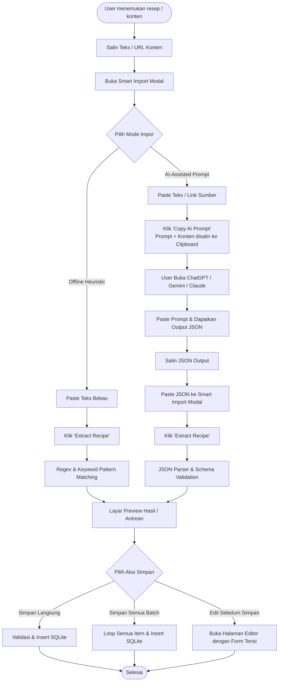
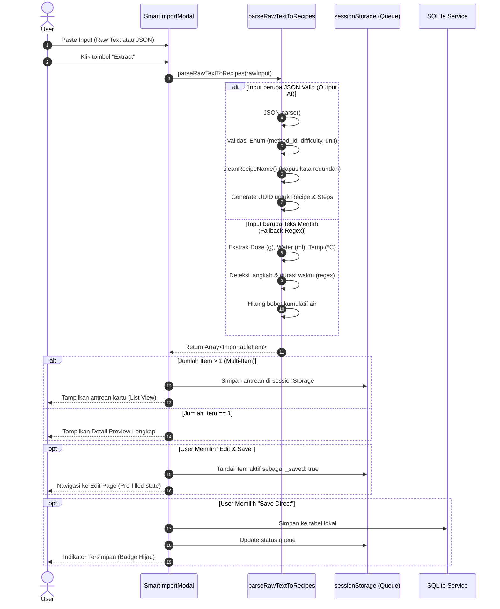

# Smart Import Architecture & Implementation Guide
> **Pola Desain: Hybrid Heuristic + AI-Assisted Clipboard Bridge (Human-in-the-Loop)**

Dokumen ini menjelaskan arsitektur, konsep desain, diagram alur, dan panduan implementasi fitur **Smart Import** yang digunakan di Coffee Flow. Pola ini dapat diadaptasi untuk aplikasi atau domain lain (misal: resep kuliner, invoice/keuangan, ringkasan buku, workout plan, atau e-commerce).

---

## 1. Latar Belakang & Filosofi Desain

### Masalah yang Dihadapi
1. **Input Manual Melelahkan**: Pengguna menemukan data kompleks di media sosial (Instagram, TikTok, YouTube, WhatsApp, artikel web). Mengetik ulang puluhan parameter sangat memakan waktu.
2. **Anti-Scraping / Paywall**: Platform modern memblokir bot web scraping (Cloudflare, CAPTCHA, login wall).
3. **Biaya & Infrastruktur Backend**: Memasang headless browser (Puppeteer/Playwright) atau memanggil LLM API (OpenAI/Anthropic) dari backend setiap kali user import membutuhkan server mahal dan biaya token yang tidak sedikit.
4. **Offline-First & Privasi**: Pengguna mobile menginginkan data tersimpan lokal (SQLite/IndexedDB) tanpa mengirim data pribadi ke server perantara.

### Solusi: Hybrid Two-Tier Architecture
```ini
                         ┌─────────────────────────────────┐
                         │      Sumber Konten Eksternal    │
                         │ (IG, TikTok, Web, Catatan Chat) │
                         └────────────────┬────────────────┘
                                          │ Copy teks / link
                                          ▼
                         ┌─────────────────────────────────┐
                         │        Smart Import Modal       │
                         └───────┬─────────────────┬───────┘
                                 │                 │
                ┌────────────────┴───┐         ┌───┴────────────────┐
                │   Mode 1: Offline  │         │   Mode 2: AI Prompt│
                │  (Local Heuristic) │         │ (Human-in-the-Loop)│
                └────────┬───────────┘         └───┬────────────────┘
                         │                         │
                         │ Regex Extraction        │ Copy Prompt + Teks
                         │ Zero network, $0 cost   │ Buka ChatGPT/Gemini
                         │                         │ Paste JSON kembali
                         │                         ▼
                         │             ┌────────────────────────────┐
                         │             │     Strict JSON Schema     │
                         │             └───────────┬────────────────┘
                         │                         │
                         ▼                         ▼
                    ┌───────────────────────────────────┐
                    │    Normalizer & Validation Layer  │
                    │  (Mapping Enum, Sanitasi, UUID)   │
                    └─────────────────┬─────────────────┘
                                      │
                                      ▼
                    ┌───────────────────────────────────┐
                    │   Multi-Item Queue (sessionStore) │
                    └───────┬───────────────────┬───────┘
                            │                   │
                            ▼                   ▼
                     [Save Direct]       [Edit & Save]
                            │                   │
                            ▼                   ▼
                    ┌───────────────────────────────────┐
                    │         Local DB (SQLite)         │
                    └───────────────────────────────────┘
```

1. **Tier 1 (Offline Heuristic Parser)**: Menggunakan Regex dan token matcher untuk mengekstrak parameter umum secara instan tanpa internet dan tanpa biaya.
2. **Tier 2 (AI Clipboard Bridge)**: Menggunakan *Prompt Engineering* yang sangat terstruktur. Pengguna menyalin prompt yang sudah terisi data, menjalankannya di AI favorit mereka (ChatGPT, Gemini, Claude), lalu menempelkan JSON hasilnya ke aplikasi.

---

## 2. Diagram Alur (Flow Diagrams)

### A. Alur Interaksi Pengguna (User Journey)



---

### B. Diagram Sekuens Normalisasi & Antrean (System Sequence)



---

## 3. Komponen Utama Arsitektur

### 1. The Strict System Prompt (`SYSTEM_PROMPT_TEMPLATE`)
Prompt dirancang untuk memaksa model bahasa menghasilkan JSON murni tanpa basa-basi (*zero markdown prose*).

Prinsip penting pada prompt:
- **Exact Field Names**: Mendefinisikan nama properti secara eksplisit (misal: `"instruction"`, bukan `"text"` atau `"description"`).
- **Domain Enum Values**: Memberikan daftar nilai yang diizinkan (misal: `method_id` harus salah satu dari `v60`, `aeropress`, dsb).
- **Anti-Hallucination Guardrails**: Memberikan instruksi tegas: *"Extract ONLY what the source actually states. If omitted, use null or default value"*.
- **Multi-Item Extraction**: Menginstruksikan AI untuk mengekstrak seluruh entitas jika dalam satu artikel terdapat lebih dari 1 resep/item ke dalam array JSON.
- **Few-Shot Example**: Menyertakan contoh JSON valid di akhir prompt sebagai acuan bentuk keluaran.

### 2. Dual-Tier Parser Pipeline
Fungsi parser mengimplementasikan strategi fallback otomatis:
```typescript
export function parseRawTextToItems(rawText: string): ImportableItem[] {
    // 1. Coba ekstrak JSON (jika user mem-paste respon AI)
    try {
        const jsonMatch = rawText.match(/\[[\s\S]*\]|\{[\s\S]*\}/);
        if (jsonMatch) {
            const parsed = JSON.parse(jsonMatch[0]);
            const list = Array.isArray(parsed) ? parsed : [parsed];
            return list.map(normalizeAndSanitize);
        }
    } catch {
        // Jika JSON invalid, lanjutkan ke Tier 2
    }

    // 2. Tier 2: Heuristic Regex Parser (100% Offline)
    return parseOfflineRegex(rawText);
}
```

### 3. Normalizer & Sanitizer Layer
AI sering kali menghasilkan output yang sedikit melenceng dari standar aplikasi. Lapisan sanitasi bertugas:
- **Title Cleaner**: Menghapus redundansi nama (misal judul resep `"V60 Pour Over Recipe - James Hoffmann"` diubah menjadi `"James Hoffmann"` karena kategori alat sudah disimpan terpisah).
- **Step Timing Normalizer**: Memastikan setiap step memiliki durasi detik positif agar timer aplikasi dapat berjalan.
- **UUID Generator**: Memberikan identifier unik standar (`crypto.randomUUID()`) pada level entitas utama dan sub-komponen.

### 4. Queue State Management (`sessionStorage`)
Ketika satu artikel memuat 3 varian item:
- Seluruh hasil parse disimpan ke `sessionStorage` (misal: `coffee_flow_import_queue`).
- Setiap item memiliki metadata runtime: `_saved: boolean`.
- Jika user memilih untuk mengedit item ke-1 di form editor, navigasi berpindah halaman.
- Saat kembali, antrean item ke-2 dan ke-3 tetap utuh dan item ke-1 ditandai telah selesai.

---

## 4. Portability Blueprint: Cara Menerapkan di Domain Lain

Pola arsitektur ini bersifat **universal** dan bisa diterapkan di berbagai use case. Berikut panduan langkah demi langkahnya:

### Langkah 1: Tentukan Schema Target
Tentukan antarmuka data aplikasi Anda:
```typescript
export interface TargetEntity {
    id: string;
    title: string;
    category: 'Finance' | 'Tech' | 'Health';
    amount?: number;
    tags: string[];
    steps: { order: number; text: string }[];
}
```

### Langkah 2: Buat Template Prompt AI
Buat template prompt yang menyertakan schema di atas dan instruksi ketat:
```typescript
export const DOMAIN_PROMPT_TEMPLATE = `
Extract all records from this text/link into strict JSON format (JSON only, no markdown outside).

SCHEMA RULES:
1. "title": Concise, clean title.
2. "category": Must be ONE of: "Finance", "Tech", "Health".
3. "amount": Number only (null if not mentioned).
4. "tags": String array.
5. "steps": Array of { "order": integer, "text": string }.

If multiple records exist, return a JSON array: [ { ... }, { ... } ].

OUTPUT FORMAT EXAMPLE:
[
  {
    "title": "Expense Tracking",
    "category": "Finance",
    "amount": 150000,
    "tags": ["food", "groceries"],
    "steps": [{ "order": 1, "text": "Bought vegetables" }]
  }
]
`;
```

### Langkah 3: Implementasikan UI Modal
Sediakan dua tab/mode:
- **Mode AI**: Input field untuk link/teks -> Tombol 1-tap "Copy Prompt" -> Input field untuk paste JSON hasil AI -> Tombol "Extract".
- **Mode Offline**: Input field teks mentah -> Tombol "Extract Directly".

### Langkah 4: Terapkan Validasi & Multi-Queue
- Gunakan `sessionStorage` untuk menyimpan antrean import.
- Sediakan tombol **Save Direct** (untuk langsung masuk DB) dan **Customize / Edit** (buka form create dengan data pre-filled).

---

## 5. Keuntungan Pola Ini Dibanding Solusi Lain

| Indikator | Direct LLM API Call | Backend Scraper Bot | Smart Import (Pola App Ini) |
|---|---|---|---|
| **Biaya Server / Cloud** | Mahal ($$$ token bulanan) | Sedang (server, proxy IP) | **$0 (Zero Infrastructure)** |
| **Ketergantungan Jaringan** | Butuh internet stabil | Butuh internet | **Bisa bekerja offline (Tier 1)** |
| **Keandalan Scraping** | Sering gagal jika web diproteksi | Sering diblokir CAPTCHA | **Tinggi (User / LLM membaca konteks)** |
| **Privasi Pengguna** | Data dikirim ke API vendor | Data masuk ke server pengembang | **Tinggi (Semua proses di browser/klien)** |
| **Maintenance Code** | Perlu maintenance SDK & billing | Perlu maintenance CSS selector | **Rendah (Hanya memelihara schema prompt)** |

---

## 6. Referensi File Implementasi di Coffee Flow
- Komponen Resep Kopi: [SmartImportModal.tsx](file:///Users/ruangguru/Documents/Bungkuss/coffee-flow-v3/src/components/SmartImportModal.tsx)
- Komponen Minuman (Drink): [DrinkSmartImportModal.tsx](file:///Users/ruangguru/Documents/Bungkuss/coffee-flow-v3/src/components/DrinkSmartImportModal.tsx)
- Halaman Pemanggil: [RecipeListPage.tsx](file:///Users/ruangguru/Documents/Bungkuss/coffee-flow-v3/src/pages/RecipeListPage.tsx) & [DrinkListPage.tsx](file:///Users/ruangguru/Documents/Bungkuss/coffee-flow-v3/src/pages/DrinkListPage.tsx)
